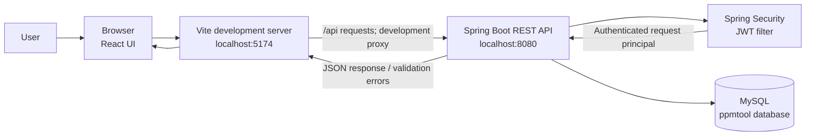
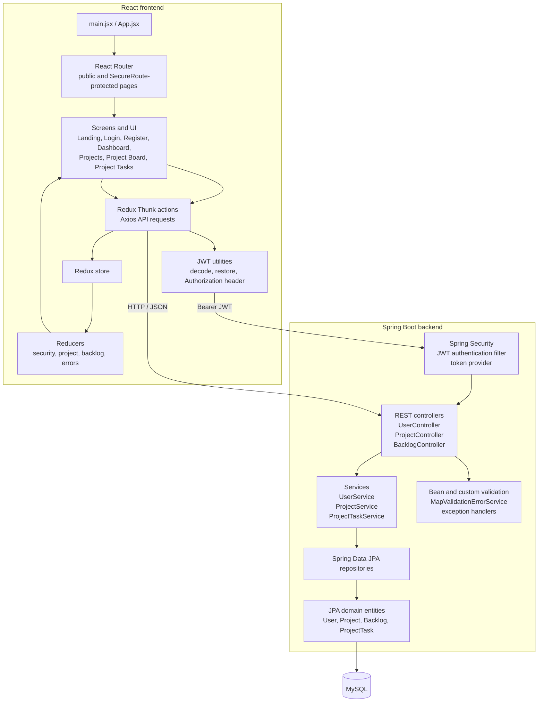
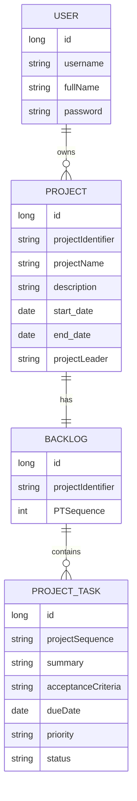
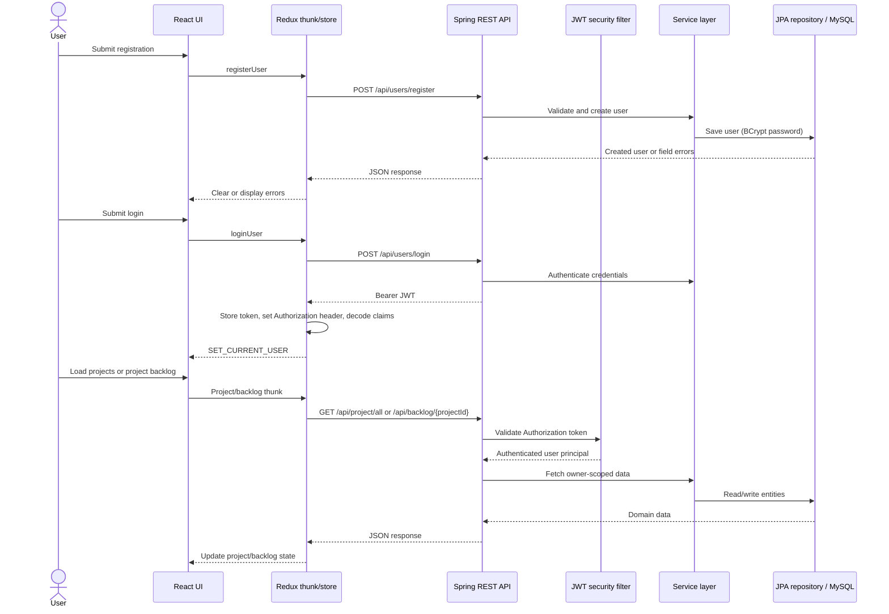

# PMTool Architecture

## System context

In development, Vite forwards requests under `/api` to the Spring Boot server.
The frontend stores the issued JWT in browser local storage and sends it in the
`Authorization` header for subsequent API calls. The backend validates the
token and resolves the authenticated user for protected endpoints.

## Application components

## Domain model

Each project belongs to a user and has one backlog. A backlog contains project
tasks. Project and task APIs use the authenticated principal to scope data to
its owner.

## Main request flows

## API areas

| Area | Routes | Responsibility |
|---|---|---|
| Authentication | `POST /api/users/register`, `POST /api/users/login` | Register users, validate credentials, issue JWT |
| Projects | `/api/project` | Create, list, fetch, and delete owner-scoped projects |
| Backlog/tasks | `/api/backlog/{projectId}` | List/create project tasks; fetch/update/delete a task by sequence |

Validation errors are returned as JSON field-to-message maps and stored in the
frontend Redux `errors` state for form feedback.
